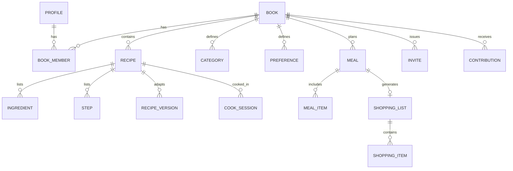

# Family Cookbook — Build Plan & Claude Code Prompts

Based on PRD v1.2 (Nov 2026) and the working Google Doc cookbook. Decisions locked: **any family can sign up with its own book**, **web app / PWA**, **built with Claude Code**.

---

## 1. What changes from the PRD

The PRD was written for one owner (Efrat). Making it multi-family changes the foundations rather than the features, so it has to be decided before line one of code.

| PRD says                                         | Plan says                                                                                     | Why                                                |
|--------------------------------------------------|-----------------------------------------------------------------------------------------------|----------------------------------------------------|
| "Efrat" is the owner                             | Every **Book** has one owner; a person can own one book and be a viewer/contributor in others | A kid can keep her own book and still see mom's    |
| 11 fixed categories                              | 11 categories are a **seeded default**, editable per book                                     | Other families organize differently                |
| Fixed pantry list, store-section order, dislikes | All **per book**                                                                              | Same reason                                        |
| One-time import from "the doc"                   | Reusable **importers** any family can run; Efrat's doc becomes the test fixture               | Onboarding is the product now                      |
| "No Keep API, so no sync"                        | Still true — but **Google Takeout exports Keep as JSON with labels and image attachments**    | Recovers exactly what the Doc export lost (see §4) |

Features in the existing doc that the app must keep, because the family already relies on them: category index with counts, "back to contents" on every recipe (→ persistent bottom nav), "add to meal via WhatsApp" (→ one-tap add-to-tray, plus a WhatsApp share later), and a source link on every recipe.

---

## 2. Stack

| Layer               | Choice                                                             | Reason                                                                                                                                                           |
|---------------------|--------------------------------------------------------------------|------------------------------------------------------------------------------------------------------------------------------------------------------------------|
| App                 | Next.js (App Router) + TypeScript                                  | One codebase for UI and server routes; Claude Code knows it well                                                                                                 |
| Data / auth / files | Supabase: Postgres, Auth, Storage, Realtime                        | Row-Level Security makes "nobody sees a book without an invite" enforceable in the database, not just the UI; Realtime gives cross-device cook sessions for free |
| PWA                 | Serwist (service worker) + web manifest                            | Install to home screen, offline reading later                                                                                                                    |
| Styling             | Tailwind with **logical properties only** (`ms-`, `pe-`, `start-`) | RTL correctness by construction                                                                                                                                  |
| Motion              | Motion (motion.dev) springs                                        | Interruptible sheets/drawers (see §5)                                                                                                                            |
| AI                  | Claude (subscription via headless Claude Code, or Anthropic API), server-side only | Extraction, translation, OCR, ingredient normalization. Model names in env vars                                                                                  |
| Hosting             | Vercel + Supabase cloud                                            | Zero-ops                                                                                                                                                         |

**Hebrew search note:** Postgres full-text search has no Hebrew stemmer. Use `pg_trgm` trigram search on a normalized column (niqqud stripped, final letters ך/ם/ן/ף/ץ folded) — it handles plurals and typos well enough for a few hundred recipes per book.

---

## 3. Data model (multi-tenant)

Every content table carries `book_id`. RLS policy pattern: *a row is visible if the user has a non-revoked membership in its book*; writes depend on role.



Key decisions inside the model:

- **`book_member.role`**: `owner | contributor | viewer`, plus `revoked_at`. Exactly one owner per book (enforced by a partial unique index).
- **`recipe.status`**: `draft | pending | approved | rejected`. Only `approved` is visible to viewers, search and the menu builder. Owner-created recipes are `approved` immediately. Adding this in the MVP costs nothing and saves a migration in Phase 2.
- **`ingredient`** stores both the display text (`"3 גזרים, פרוסים"`) and parsed fields: `quantity`, `unit` (metric base), `canonical_name` (`גזר`), `section`, `optional`. **Normalization happens once, when the recipe is saved**, not when a shopping list is built — lists stay instant and deterministic.
- **Menu-builder helper fields on recipe** from day one (PRD §13.5): `dish_role`, `uses_oven`, `oven_temp`, `uses_stovetop`, `make_ahead`, `active_minutes`, `cuisine`. The parser fills them during import (Efrat's doc has oven temperatures buried in free text like "תנור על 160 מעלות").
- **`cook_session`**: `recipe_id/version_id`, `servings`, `checked_ingredient_ids[]`, `current_step`, `last_active_at`. Synced via Realtime.
- **`invite`**: single-use token bound to an email, expires in 7 days, consumed by the first sign-in with that email. This is not a public link and matches the PRD's "no public links" rule.

---

## 4. Importers

| Source                    | Method                                                                                              | Notes                                                                                                                                                    |
|---------------------------|-----------------------------------------------------------------------------------------------------|----------------------------------------------------------------------------------------------------------------------------------------------------------|
| **Google Keep (Takeout)** | Upload the Takeout ZIP; parse each note's `.json` (`title`, `textContent`, `labels`, `attachments`) | Labels → tags/categories, images come back. Best path for new families migrating from Keep, and possibly a way to recover Efrat's lost photos and labels |
| Google Doc / PDF          | Split by headings → one recipe per heading → AI structuring                                         | Efrat's doc: 191 recipes across 11 categories (PRD says 185; reconcile on import)                                                                        |
| URL                       | schema.org `Recipe` JSON-LD first; AI fallback; translate to Hebrew if needed                       | Always save source name + URL                                                                                                                            |
| Paste                     | AI structuring                                                                                      |                                                                                                                                                          |
| Photo / screenshot        | Claude vision → structure                                                                           | Phase 2                                                                                                                                                  |

**Every importer goes through one review screen.** It shows extracted fields, flags low-confidence fields, and warns about duplicates (trigram title similarity plus ingredient overlap). The fixture already contains test cases: "מוסקה של קורין" / "מוסקה – קורין", two "פולנטה של מחניודה", two "עוף בלימון". Bulk imports get a batch review with "merge / keep both / skip".

---

## 5. Design direction (apple-design)

The kitchen is the design brief: phone on the counter, wet hands, glancing from a distance.

- **Feedback on pointer-down, never on release.** Every button and checkbox row responds instantly with a `scale(0.97)` press state. In cook mode the whole row is the target.
- **The ingredients panel is a bottom sheet driven by springs** (damping 0.8, response 0.3, as Apple ships for drawers). It tracks the finger 1:1, can be grabbed mid-animation, and snaps to collapsed or open based on release velocity. Collapsed, it shows only the next unchecked ingredient. Tap-to-toggle must also work, since swipes are hard with dirty hands. On tablet it becomes a fixed side panel, open by default.
- **Everything else uses critically damped springs** (damping 1.0). Bounce only where the gesture carried momentum.
- **Checked items sink with motion, not a jump**, so the eye can follow what moved.
- **Undo beats confirm.** Removing a dish from the tray or unchecking a shopping item shows a 5-second "בטל" toast. Confirmation dialogs only for deleting a recipe or revoking access.
- **Responsibility:** a recipe containing an excluded ingredient (cardamom anywhere; parsley in sweet-potato soup) shows a warning chip on its card, its page, and in menu suggestions. It is never silently hidden, and the menu builder never suggests it.
- **Typography:** system font stack (`system-ui`, falls back to Arial Hebrew/Heebo). Cook-mode step text uses `clamp(1.75rem, 6vw, 3rem)` with tight leading. Sizes in `rem` so iOS text-size settings scale the layout.
- **Translucent chrome:** bottom nav and meal tray pill use `backdrop-filter` blur, with solid fallbacks under `prefers-reduced-transparency`.
- **Reduced motion:** sheets cross-fade instead of sliding.
- **Wayfinding:** four bottom tabs named for what's in them: ספרייה · ארוחות · קניות · הוספה. These replace the doc's "↑ back to contents" links.

**Platform check:** the Screen Wake Lock API that keeps the display on in cook mode did not work in home-screen web apps for a long time. It was fixed in **iOS 18.4**. Cook mode should re-acquire the lock on `visibilitychange` and show a gentle notice on older iOS versions.

---

## 6. Phases

Each phase ends with a working product. Every milestone is one Claude Code prompt (§7).

### Phase 0 — Foundation (prompts 1–2)

Repo, `CLAUDE.md`, Supabase schema + RLS, auth, book creation on signup, Hebrew RTL shell, PWA install. **Gate:** two test accounts cannot see each other's books. Proven by automated RLS tests, not by clicking around.

### Phase 1 — MVP (prompts 3–9)

1.  Library and recipe page (grid, category chips, trigram search, recipe page with source credit).
2.  Add recipe from URL or paste, plus the review screen.
3.  Bulk import from Doc/PDF and from Keep Takeout, with duplicate detection.
4.  Meal tray and meals (floating counter, saved meal with date, combined "meal page").
5.  Smart shopping list (unit merging, sections, "probably at home," sinking checkboxes, rebuild on dish swap).
6.  Cook mode (huge step text, wake lock, ingredients sheet, synced cook sessions).
7.  Sharing (email invites, viewer role, revoke) and **full JSON export from day one**.

**Gate:** Efrat's 191 recipes imported; a full Friday flow (pick 6 dishes → list → swap one → cook one) works on an iPhone from the home screen.

### Phase 2 (prompts 10–13)

Serving scaling everywhere; personal versions with a default; favorites, "worked / didn't work" and notes; free tags; ingredient search ("what can I make with X"); photo/OCR import; contributor role with approval inbox; rule-based menu builder (category balance, saved constraints, shared-ingredient savings); ingredient↔step linking in cook mode.

### Phase 3

Timers in steps; diet filters; advanced menu builder (oven/burner clashes, prep load, AI "why it fits"); contributor-proposed versions; WhatsApp notifications and "add to meal" sharing; shared meal page; print views; offline book; source link health checks; weekly planning.

### Before opening sign-ups to other families

Per-book AI usage limits (imports cost money), account and book deletion, privacy policy, abuse-safe invite emails, and a decision on pricing. None of this blocks building for your own family first.

---

## 7. Claude Code prompts

Paste one prompt per session, in order. Each assumes the previous ones were completed and merged.

> ⚠️ These prompts are for an agentic tool with real system access. Review the scope locks, forbidden actions, and stop conditions before pasting. Confirm file paths, directories, and permissions match the actual project.

### Prompt 1 — Project setup and CLAUDE.md

```text
## Objective
Scaffold a Hebrew-first, RTL, multi-family recipe PWA and write the CLAUDE.md that will govern all future sessions.

## Context
New empty repo. Product spec: docs/PRD.md (I will add it; Hebrew). Build plan: docs/PLAN.md. Any family can sign up and own a private "book" of recipes; others see it only by per-person invite.

## Target State
- Next.js (App Router, TypeScript strict), Tailwind, ESLint, Prettier, Vitest, Playwright installed and configured.
- <html lang="he" dir="rtl">; system-ui font stack; Tailwind configured so only logical utilities are used (add an ESLint rule or a grep-based CI check that fails on ml-/mr-/pl-/pr-/left-/right- classes).
- PWA: web manifest (name "ספר המתכונים", dir rtl, display standalone, icons placeholder), Serwist service worker registered.
- App shell with 4 bottom tabs (ספרייה, ארוחות, קניות, הוספה) as empty pages; translucent bottom bar with backdrop-filter and a solid fallback under prefers-reduced-transparency.
- CLAUDE.md at repo root containing: stack; RTL rules (logical properties only, Hebrew UI strings in one file src/i18n/he.ts); data rule "every content table has book_id and RLS"; "no unsaved draft state in recipe editing — save immediately"; metric units only; motion rules (springs via Motion, damping 1.0 default, 0.8 for sheets, respect prefers-reduced-motion); "AI calls server-side only, model names from env"; test commands.

## Constraints
- Only make changes directly requested. Do not add features beyond this list.
- No Supabase yet.

## Acceptance Criteria
- [ ] `npm run build`, `npm run lint`, `npm test` all pass
- [ ] Lighthouse PWA installability passes on localhost
- [ ] The RTL class check fails when I add `ml-2` anywhere

## Stop Conditions
Stop and ask before adding any dependency not named above.

## Progress
After each step: ✅ [what was done] — [files]
```

### Prompt 2 — Database, RLS, auth

```text
## Objective
Create the multi-tenant Supabase schema with Row-Level Security and email auth, so that no user can ever read another book's data.

## Context
Read CLAUDE.md and docs/PLAN.md §3 first. Supabase CLI is installed and a local project runs via `supabase start`.

## Target State
Migrations for: profiles, books, book_members (role owner|contributor|viewer, revoked_at, unique one owner per book), categories (per book, seeded with the 11 defaults from PRD appendix A on book creation), recipes (incl. status draft|pending|approved|rejected, source_url, source_name, created_by, dish_role, uses_oven, oven_temp, uses_stovetop, make_ahead, active_minutes, cuisine, prep_time, cook_time, servings, search_text), ingredients (display_text, quantity, unit, canonical_name, section enum per PRD §6, optional, position, stable id), steps, recipe_images (Storage bucket, private, path prefixed by book_id), invites (email, token hash, expires_at, consumed_at), preferences (scope global|category|recipe, excluded_ingredients[]).
- pg_trgm enabled; search_text = title + ingredient canonical names, normalized (strip niqqud, fold final letters) via a SQL function + trigger.
- RLS on every table: read requires a non-revoked membership; viewers read only status='approved'; insert/update/delete per role (owner all; contributor insert own pending rows and edit own until approved).
- Storage policies mirror table RLS.
- Signup trigger creates profile + a book + owner membership + default categories.
- Email magic-link auth wired into the Next.js app with server-side session handling.

## Constraints
- Only make changes directly requested.
- Use generated TypeScript types from Supabase.

## Acceptance Criteria
- [ ] Automated test (pgTAP or Vitest against local Supabase): user A cannot select, insert, update or delete any row in user B's book, on every table and the Storage bucket
- [ ] A viewer cannot see a pending recipe; a revoked member sees nothing
- [ ] Signing up creates exactly one book with 11 categories

## Stop Conditions
Stop and ask before: dropping or editing an applied migration; disabling RLS on any table, even temporarily.

## Progress
After each step: ✅ [what was done] — [files]
```

### Prompt 3 — Library and recipe page

```text
## Objective
Build the library (screen 1) and recipe page (screen 2) from the PRD wireframes.

## Context
Read CLAUDE.md, PRD §5.1 and §12 (screens 1–2). Schema exists. Seed script: add 8 Hebrew sample recipes to a dev book.

## Target State
- Library: search field on top (trigram search on search_text, debounced ≤150ms, results update as you type), horizontally scrolling category chips with counts, 2-column card grid (image or placeholder, title, category · time). Empty state with a single "הוספת מתכון" button.
- Recipe page: hero image, title, chips (category, tags, time), source line "מקור: <name>" linking out, primary "הוספה לארוחה +" and secondary "מצב בישול" buttons (wire to no-ops for now), ingredients list, numbered steps.
- Press feedback on pointer-down (scale 0.97, 100ms) on every tappable element.
- Warning chip on cards/pages when a recipe contains an excluded ingredient per the book's preferences (global or matching this recipe).

## Constraints
- Only make changes directly requested. Hebrew strings in src/i18n/he.ts.
- Mobile first; tablet: 3–4 columns.

## Acceptance Criteria
- [ ] Searching "גזרים" finds a recipe whose ingredient is "גזר"
- [ ] Playwright test on iPhone viewport: open library → filter category → open recipe → source link has rel="noopener"
- [ ] RTL check passes; no horizontal scroll at 360px width

## Progress
After each step: ✅ [what was done] — [files]
```

### Prompt 4 — Add recipe from URL or paste, with review

```text
## Objective
Let the book owner add a recipe from a URL or pasted text, review the extraction, and save it.

## Context
Read CLAUDE.md, PRD §7 and §13.3 (screen 7). AI provider per CLAUDE.md: headless Claude Code with CLAUDE_CODE_OAUTH_TOKEN (the owner's Claude subscription), falling back to ANTHROPIC_API_KEY. Env vars: CLAUDE_CODE_OAUTH_TOKEN, ANTHROPIC_API_KEY, AI_PROVIDER, AI_MODEL_EXTRACT (default sonnet), AI_MODEL_FAST (default haiku).

## Target State
- Server route /api/import/url: fetch page server-side; if schema.org Recipe JSON-LD exists, map it; else send cleaned page text to AI_MODEL_EXTRACT with a strict JSON schema (title, servings, times, ingredients[{display_text, quantity, unit, canonical_name, section, optional}], steps[], dish_role, uses_oven, oven_temp, make_ahead, cuisine, confidence per field, source_language).
- If source_language ≠ he: translate to natural Hebrew in the same call; keep the original URL and source name.
- /api/import/paste: same structuring from free text.
- Normalization: units converted to metric base (tbsp=15ml, tsp=5ml, cup=240ml per PRD §8); canonical_name singular Hebrew; section from the fixed list.
- Review screen: all fields editable; fields with confidence < 0.7 highlighted; category picker; duplicate warning if a recipe in this book has trigram title similarity > 0.6 or ingredient overlap > 70%, with "פתיחת הקיים" / "שמירה כחדש".
- Save writes immediately (no draft limbo).
- Validate AI output with zod; on failure, retry once, then show the raw text in the paste editor.

## Constraints
- Only make changes directly requested. AI calls server-side only. Never log page contents or API keys.
- SSRF protection on URL fetch: block private IPs, max 2MB, 10s timeout.

## Acceptance Criteria
- [ ] Unit tests with 3 saved HTML fixtures (one JSON-LD English, one Hebrew without JSON-LD, one non-recipe page → clear error)
- [ ] English recipe is saved in Hebrew with the original source URL
- [ ] Duplicate warning appears when importing the same URL twice

## Stop Conditions
Stop and ask before adding a scraping or headless-browser dependency.

## Progress
After each step: ✅ [what was done] — [files]
```

### Prompt 5 — Bulk import (Doc/PDF and Google Keep Takeout)

```text
## Objective
Let a new family import their whole existing collection in one go, from a Google Doc/PDF export or a Google Keep Takeout ZIP.

## Context
Read CLAUDE.md and PLAN.md §4. Fixture: fixtures/efrat-cookbook.pdf (191 recipes, 11 category headings, each recipe heading followed by a "↑ לתוכן העניינים · הוספה לארוחה בוואטסאפ" line to strip, optional "מקור המתכון" link, bullet ingredients, plain-text steps). Keep Takeout: each note is a .json with title, textContent, listContent, labels[{name}], attachments[{filePath, mimetype}], createdTimestampUsec.

## Target State
- Upload UI accepting .pdf, .docx, .zip. Processing runs as a background job with progress ("47/191"); the user can leave and come back.
- Doc/PDF: deterministic split by category and recipe headings first; AI only structures each recipe body (reuse the Prompt 4 pipeline). Category headings become the book's categories: match existing categories by name, create new ones for the rest, and show a mapping screen (heading → category, with counts) before importing, per PRD §7.3.
- Keep: one recipe per note; labels → tags, with a mapping screen to assign labels to categories; image attachments uploaded to Storage; created time preserved.
- Notes/entries that are only a link → queued for URL import (Prompt 4 route), keeping the link as source.
- Empty entries → listed as "ריק — למחוק?".
- Batch review: duplicates grouped (title trigram + ingredient overlap) with merge / keep both / skip; recipes without images flagged with a placeholder and a "צלמי בבישול הבא" reminder.

## Constraints
- Only make changes directly requested. Imported recipes are owner-approved immediately.
- Cap AI calls per import job; show estimated count before starting.

## Acceptance Criteria
- [ ] Fixture import yields 191 recipes in 11 categories named exactly as the fixture's category headings, ±0 after review
- [ ] Duplicate groups include "מוסקה של קורין"/"מוסקה – קורין" and both "עוף בלימון" entries
- [ ] A recipe containing "תנור על 160 מעלות" gets uses_oven=true, oven_temp=160
- [ ] Re-running the same import offers "skip all duplicates"

## Progress
After each step: ✅ [what was done] — [files]
```

### Prompt 6 — Meal tray and meals

```text
## Objective
Implement meal planning: add dishes from anywhere to a floating meal tray, save a meal with a date, and view a combined meal page.

## Context
Read CLAUDE.md, PRD §8 and §12 (screens 1 and 4).

## Target State
- Tables: meals (book_id, title, date, status draft|done|closed), meal_items (recipe_id, version_id nullable, servings, position). RLS like other tables.
- "הוספה לארוחה" on cards and recipe pages adds to the current draft meal; floating pill "מגש הארוחה · N" above the bottom nav with a spring count bump.
- Meal screen: title + date ("ארוחת שישי · 14.11", Hebrew date formatting), dish rows with "החלפה" (opens library in pick mode) and "הסרה" (undo toast for 5s, no confirm dialog), "הוספת מנה +", primary "יצירת רשימת קניות".
- "דף ארוחה": one scrollable page with all selected recipes in full.

## Constraints
- Only make changes directly requested. Shopping list itself is the next prompt; the button navigates to a stub.

## Acceptance Criteria
- [ ] Playwright: add 6 dishes → save as Friday meal → swap one → undo a removal
- [ ] Tray count persists across reloads and devices (server state)

## Progress
After each step: ✅ [what was done] — [files]
```

### Prompt 7 — Smart shopping list

```text
## Objective
Generate one merged shopping list per meal, grouped by store section, and rebuild it instantly when a dish changes.

## Context
Read CLAUDE.md, PRD §8 and screen 5. Ingredients already carry canonical_name, quantity, unit (metric base), section.

## Target State
- Pure function buildShoppingList(mealItems, recipes, pantry) in src/lib/shopping.ts: group by canonical_name+unit family, sum, round to a buyable amount (e.g. 330g → 350g; counts round up), keep fromRecipes[], sort sections in PRD order, move pantry items (per-book list, seeded: שמן, מלח, פלפל, קמח, סוכר, common spices) to "כנראה יש בבית".
- Items without quantity ("מלח ופלפל") are listed once without amount.
- Stored list (shopping_lists, shopping_items with checked, in_pantry) — rebuilding preserves checked state for items that still exist.
- UI: section headers, whole-row checkbox targets, checked items get strikethrough and animate to the bottom of their section, "(מרק + סלט)" source hint, collapsed "כבר יש בבית (N)" group, footer: שיתוף (Web Share API, plain text), הדפסה, סיימתי.
- Editing the meal (swap/remove/add) rebuilds the list immediately.

## Constraints
- Only make changes directly requested. No AI calls in list building.

## Acceptance Criteria
- [ ] Unit tests: 2 tbsp + 30ml oil → 60ml; 3 carrots + 2 carrots → 5 יח׳ with both sources; pantry item hidden by default
- [ ] Swapping a dish removes only its non-shared ingredients and keeps checks on the rest
- [ ] Works with 6 recipes in under 50ms

## Progress
After each step: ✅ [what was done] — [files]
```

### Prompt 8 — Cook mode with floating ingredients panel

```text
## Objective
Build cook mode (screen 3, PRD §14): one huge step at a time, screen stays on, and a floating ingredients panel to tick off what's already in the pot, synced across devices.

## Context
Read CLAUDE.md and PRD §14 in full; PLAN.md §5 for motion values. Target devices: iPhone home-screen PWA (iOS 18.4+ supports Wake Lock there) and iPad.

## Target State
- Route /cook/[recipeId]: header "שלב 2 מתוך 7 · <title>", step text clamp(1.75rem, 6vw, 3rem), large "הקודם" / "השלב הבא" buttons at the bottom.
- Screen Wake Lock acquired on enter, re-acquired on visibilitychange, released on exit; if unsupported, show a small dismissible note.
- Ingredients bottom sheet (Motion spring, damping 0.8, response 0.3): drag handle shows "מצרכים 3/12"; tracks finger 1:1 with pointer capture, interruptible mid-animation, snaps by release velocity; tapping the handle also toggles. Collapsed shows only the next unchecked ingredient. Entire row toggles a check; checked rows strike through and sink. All checked → "הכול נוסף ✓" with a button to the last step.
- Tablet (≥768px): fixed side panel on the start (right) side, open by default, no sheet.
- cook_sessions table; state saved on every change and synced with Supabase Realtime, so a session started on the phone continues on the tablet. Reopening offers "להמשיך" / "להתחיל מחדש". One active session per recipe per user.
- Ingredient ids are stable, so checks survive servings changes and recipe edits.
- prefers-reduced-motion: sheet cross-fades instead of sliding.

## Constraints
- Only make changes directly requested. No timers yet (Phase 3). No swipe-only actions; everything must work by tap.

## Acceptance Criteria
- [ ] Two browser contexts on the same session: checking on one appears on the other within 1s
- [ ] Grabbing the sheet mid-animation does not jump
- [ ] On iOS home-screen PWA, screen stays on for 10+ minutes in cook mode (manual check listed in PR description)

## Progress
After each step: ✅ [what was done] — [files]
```

### Prompt 9 — Sharing and export

```text
## Objective
Let the owner invite specific people as viewers, see who has access, revoke instantly, and export the whole book.

## Context
Read CLAUDE.md, PRD §2 and §9. Invites table exists.

## Target State
- Settings → "מי רואה את הספר": list of members with role and invited date; "הזמנה" by email creates a single-use invite (hashed token, 7-day expiry) and sends a Hebrew email via Supabase Auth; the invitee lands in the book after signing in with that email only.
- Revoke sets revoked_at; RLS immediately blocks access (no cached data shown after revocation on next request).
- Viewers see the library, recipes, cook mode, but no edit/add/delete controls and no tray-to-list on the owner's meals unless shared (Phase 3).
- A user in several books gets a book switcher in the header.
- Export: "ייצוא מלא" downloads a JSON of all recipes (with ingredient/step/version data and image URLs signed for 7 days) and a printable HTML/PDF of the book with a clickable table of contents.

## Constraints
- Only make changes directly requested. Never create a link that works without signing in.

## Acceptance Criteria
- [ ] Invite opened while signed in with a different email → refused
- [ ] Revoked viewer gets 0 rows on next fetch (automated)
- [ ] Export JSON re-imports into an empty test book with identical recipe count

## Stop Conditions
Stop and ask before changing any RLS policy written in Prompt 2.

## Progress
After each step: ✅ [what was done] — [files]
```

### Phase 2 prompts (outline — run in this order)

Write each in the same shape as the prompts above when you reach it. The scope for each:

10. **Scaling + versions + notes.** Servings stepper on the recipe page, in cook mode and in meal items (flows into the shopping list); "הגרסה שלי" versions with source credit and a default flag; favorites; "עבד / לא עבד"; notes; a one-tap "בישלתי" at the end of cook mode.
11. **Contributors and approval inbox.** `canContribute` toggle per member; contributors add via URL/paste/photo → `pending`; owner inbox with approve / edit & approve / reject with note / approve as version. Recommended defaults for PRD §13.6: only explicitly marked contributors; contributors see the shared book plus their own submissions; rejected items stay visible only to their author for 30 days.
12. **Rule-based menu builder** (screen 6). Inputs: 1–2 base dishes, meal type, constraints. Scoring: fill missing dish_role first, no two heavy mains, shared canonical ingredients ("חוסך N פריטים"), make-ahead mix. Hard exclusions from preferences. Every suggestion shows its reasons, and dishes can be locked or swapped. Book recipes only.
13. **Photo import + ingredient search + tags + ingredient↔step linking.**

---

## 8. Open questions to settle before Phase 2

From PRD §13.6, with the default I'd suggest if you don't decide otherwise:

| Question                                     | Suggested default                                                                    |
|----------------------------------------------|--------------------------------------------------------------------------------------|
| Who may contribute?                          | Only people the owner explicitly marks as contributors                               |
| What do contributors see?                    | The shared book plus their own submissions                                           |
| Rejected contributions?                      | Kept for the author for 30 days, then deleted                                        |
| Pending items when a contributor is removed? | Kept in the owner's inbox                                                            |
| Hard vs. soft constraints                    | Excluded ingredients are hard; sugar/cream style preferences are soft (ranking only) |
| Kitchen equipment for clash detection        | One "המטבח שלי" settings screen: number of ovens and burners (Phase 3)               |
| Auto-approve trusted contributors?           | Off by default, per-person toggle later                                              |

And one new question created by going multi-family: **will other families pay, and who covers AI import costs?** Decide before public sign-up, not before building.
